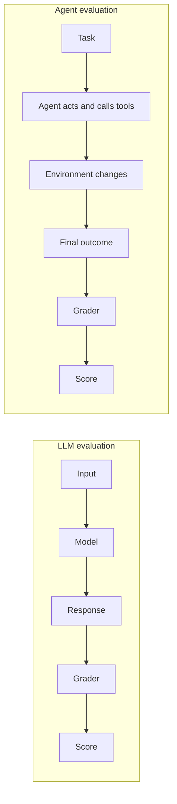
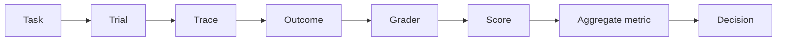
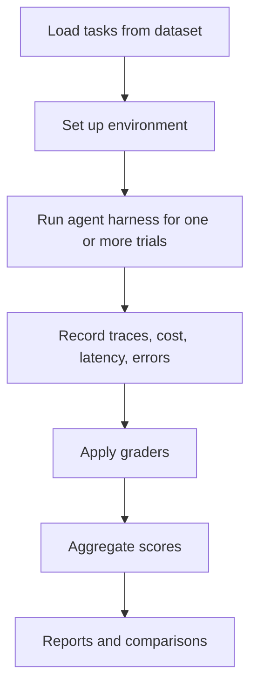
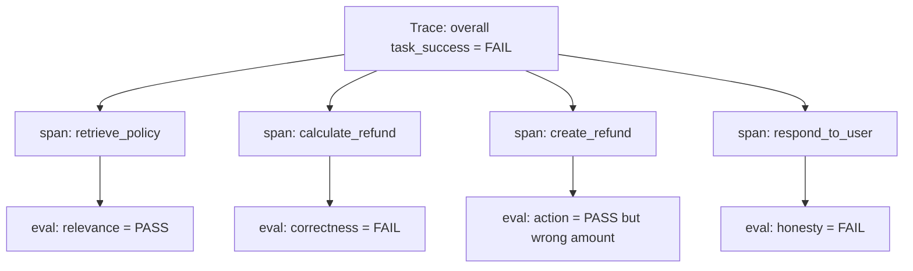
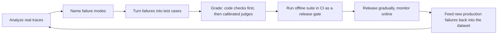

# **LLM and Agent Evaluation: Complete Notes**

## **Contents**

1. What Is an LLM Evaluation?
2. Types of Evaluation by Subject
3. Core Vocabulary
4. When and Why You Evaluate
5. Reliability Metrics: pass@k and pass^k
6. Judging the Judge: TPR and TNR
7. Reference Based vs Reference Free Evaluation
8. Span Attached Evaluation
9. The Evaluation Loop and Best Practices
10. Full Worked Example: Refund Agent
11. Quick Reference
12. Final Mental Model

The central idea:

$$
\text{Evaluation} = \text{a repeatable way to check that an AI system really does what it should}
$$

Do not rely on vibe checks. Build a closed loop: analyze failures, measure them, improve the system, automate the checks, and repeat.

## **1. What Is an LLM Evaluation?**

### **Definition**

An **LLM evaluation** is a systematic, repeatable test of an LLM or an LLM powered system against clear criteria. It is the whole testing setup, not only a score like accuracy or F1.

$$
\text{LLM Evaluation} = \text{Test Data} + \text{Success Criteria} + \text{Grader} + \text{Results}
$$

The setup answers these questions:

| Part | Question |
|---|---|
| Subject | What am I testing: a model, a prompt, a retriever, a full agent? |
| Test data | Which inputs do I use? |
| Success criteria | What counts as good? |
| Grader | Who or what decides pass or fail? |
| Runner | Which tool runs the test? |
| Timing | Before release, after release, or both? |
| Results | How do I store and compare scores across versions? |

### **Why we need it**

LLMs can sound confident and polished while being wrong. An agent may say "Your refund has been processed" while no refund exists in the database. Evaluations give evidence instead of impressions.

They help answer practical questions:

- Is this model good enough for my task?
- Did prompt v2 beat prompt v1?
- Is the RAG answer based on the retrieved documents?
- Did the agent really finish the task?
- Is it safe, fast enough, and affordable?
- Did a recent change break something that used to work?

### **LLM evaluation vs normal software testing**

| Aspect | Normal software testing | LLM evaluation |
|---|---|---|
| Output | Fixed and predictable | Often changes between runs |
| Correct answer | Usually one exact answer | Often many acceptable answers |
| Test case | Input and expected output | Input, context, tools, environment, success criteria |
| Grader | Assertions and unit tests | Code checks, LLM judges, human review |
| Main challenge | Finding bugs | Measuring quality, safety, and consistency |

A function returns `4` for `2 + 2` every time. An LLM may word the answer differently each run, or sometimes make a mistake. This is why we run the same test more than once.

### **Three requirements of a good evaluation**

| Requirement | Meaning | Example |
|---|---|---|
| Systematic | Use a planned test set with normal, hard, edge, and unsafe cases, not five random questions | 100 real student questions grouped into course info, enrollment, refunds, tech issues, unsafe requests, out of scope questions |
| Repeatable | Same test set and same process, so versions can be compared fairly | Prompt v1 scores 72 of 100, prompt v2 scores 85 of 100 on the same 100 questions |
| Clear criteria | Decide in advance what "good" means | Correct, uses official material, easy to read, no hallucination, safe, fast enough, no false promises |

Example of clear criteria on one question:

```text
Question: "Can I get a refund after attending two classes?"

Good answer: "As per the refund policy, refunds are available within 7 days
of enrollment if fewer than two live classes were attended."

Bad answer: "Yes, you can get a refund anytime."
```

The bad answer sounds helpful but breaks the policy.

## **2. Types of Evaluation by Subject**

### **Model evaluation vs application evaluation**

These names are not official standards, but they are useful.

| Type | What it tests | Main question |
|---|---|---|
| Model evaluation | The LLM itself | How capable is this model? |
| Application evaluation | The full product built on an LLM | Does this product work for real users? |

**Model evaluations** compare models and power public leaderboards. Large labs usually run them. As an AI engineer you mostly read the results to pick a model.

| Capability | Question | Example benchmark |
|---|---|---|
| Reasoning | Can it think through hard problems? | GPQA, ARC |
| General knowledge | Does it know facts across subjects? | MMLU |
| Math | Can it solve math problems? | GSM8K, MATH |
| Coding | Can it write and fix code? | HumanEval, SWE-bench |
| Instruction following | Can it follow detailed rules? | IFEval |
| Long context | Can it find facts in a long document? | Needle in a Haystack |
| Multimodal | Can it understand images, audio, video? | MMMU |
| Tool use | Can it call tools correctly? | BFCL, tau-bench |

Example of a math check: "3 pens cost ₹45. What do 7 pens cost?" The expected answer is ₹105. Answering ₹105 passes, answering ₹90 fails.

**Application evaluations** test the whole product or one part of it. A strong model does not guarantee a strong product, just as a fast processor does not guarantee a good phone. The prompt, retrieval, tools, guardrails, memory, and user experience all matter.

For a RAG chatbot you can test each part:

| Component | What you check |
|---|---|
| Retriever | Did it fetch the right documents? |
| Embedding model | Do similar questions map to similar documents? |
| Reranker | Are the most relevant documents first? |
| Prompt | Does the model use the retrieved context properly? |
| LLM | Is the generated answer correct and clear? |
| Full application | Is the final answer useful, safe, and fast? |

RAG example:

```text
Question: "What is the refund policy for a recorded course?"
Retrieved context: "Recorded course refunds are available within 7 days of purchase."

Answer A: "Refunds are available within 7 days of purchase."
  Correctness: Pass.  Groundedness: Pass.

Answer B: "You can get a refund anytime."
  Not supported by the context: Fail.
```

### **LLM evaluation vs agent evaluation**



| Aspect | LLM evaluation | Agent evaluation |
|---|---|---|
| Main unit | One prompt and one response | One task and one full agent run |
| Focus | Quality of the text | Task completion and behavior |
| Environment | Usually static | Often interactive and stateful |
| Evidence | Prompt and response | Trace, tool calls, database state, outcome |
| Example question | Is this answer correct? | Did the agent really complete the refund? |
| Main risk | Wrong or unsafe text | Wrong or unsafe action, failed task |

## **3. Core Vocabulary**



### **Task or test case**

A **task** is an input plus the rule that decides whether the system succeeded. A task is more than a prompt.

$$
\text{Task} = \text{Input} + \text{Environment} + \text{Success Criteria}
$$

The environment can include tools, APIs, databases, files, browsers, simulated users, and permissions.

```text
Task: "Refund order #12345 because the item arrived damaged."

Success criteria:
- The agent verifies the order and checks refund eligibility.
- The agent calls the refund API with the correct order ID.
- The refund amount is $49.99.
- A refund row exists in the database.
- The agent tells the customer the refund was initiated.
```

### **Trial**

A **trial** is one complete attempt at a task. A trial is the unit of measurement, and a task is the unit being measured. Because LLMs and agents are **non deterministic** (sampling, tool behavior, user simulation, and environment changes all cause variation), one run is rarely enough. Run the same task several times and combine the results.

Running the refund task 10 times gives 10 trials. This note uses the same 10 trials in later sections:

| Trial | 1 | 2 | 3 | 4 | 5 | 6 | 7 | 8 | 9 | 10 |
|---|---|---|---|---|---|---|---|---|---|---|
| Result | Pass | Pass | Fail | Pass | Pass | Pass | Fail | Pass | Pass | Pass |

So $n = 10$ trials and $c = 8$ passes. The single trial success rate is:

$$
\text{pass@1} = \frac{8}{10} = 80\%
$$

### **Grader or scorer**

A **grader** is the logic that decides if a trial passed. It can return a binary result, a numeric score, scores for several dimensions (correctness, safety, tone, speed), or structured feedback such as reasons and error types.

| Grader type | How it decides | Strength | Risk |
|---|---|---|---|
| Code based | Rules, assertions, parsers, unit tests, database checks | Cheap, fast, repeatable | Cannot judge nuanced language |
| LLM judge | An LLM applies a rubric or compares with a reference | Handles open ended quality | Can be biased, inconsistent, or gamed |
| Human | A person reviews and labels | Best for subtle quality | Slow, costly, inconsistent without guidelines |

Code based grader:

```python
def grade_refund(trace, final_state):
    if not final_state.refund_created:
        return 0
    if final_state.refund_amount != 49.99:
        return 0
    if "refund has been initiated" not in trace.final_message.lower():
        return 0
    return 1
```

LLM judge prompt:

```text
You are grading a customer support response.

Rubric:
- Does it answer the customer's question?
- Is it polite and clear?
- Does it avoid false promises?
- Does it follow company policy?

Return: PASS or FAIL, plus a one sentence reason.
```

Human grader record:

```text
Correctness: 4/5
Tone: 5/5
Policy compliance: Fail
Overall: Fail
```

**Rule:** use the cheapest reliable grader. Code checks for facts, LLM judges for subjective qualities, and humans to calibrate and audit both.

### **Trace, transcript, or trajectory**

A **trace** is the full record of one trial. It shows not only what the agent produced but how it got there. It may hold the user request, system prompt, model inputs and outputs, reasoning if available, tool calls and arguments, tool results and errors, database reads and writes, simulated user messages, latency, tokens, cost, the final response, the final environment state, and grader results.

```text
User: I want a refund for order #12345.

Agent thought: I need to look up the order and check eligibility.
Tool call:   get_order(order_id="12345")
Tool result: status="delivered", amount=49.99, refund_eligible=true

Agent thought: The order is eligible, so I will create a refund.
Tool call:   create_refund(order_id="12345", amount=49.99)
Tool result: refund_id="R-889", status="created"

Agent: "Your refund of $49.99 for order #12345 has been initiated."
```

A trace lets you ask: Did it call the right tool with the right arguments? Did it invent a tool result? Did it take an unsafe action? Was it efficient? Did it fail because of reasoning, tools, data, retrieval, or instructions? For agents the trajectory often matters as much as the final answer.

### **Outcome**

An **outcome** is the final state of the environment after the agent acts. It is what really happened, not what the agent says happened.

| Task | Agent claim | Actual outcome |
|---|---|---|
| Refund request | "Your refund has been processed." | No refund row in the database |
| Calendar booking | "Your meeting is scheduled." | No calendar event exists |
| Code fix | "The bug is fixed." | Tests still fail |
| Data analysis | "Revenue grew 12%." | Wrong column was used |
| File operation | "The report was saved." | No file exists |

Grade the observable outcome, not only the claim. Claim: "The refund was processed." Check: does a refund row exist?

### **Agent harness**

An **agent harness** is the scaffold that turns a model into an agent: tool definitions and calling logic, API clients, database and file access, browser controls, memory, retries, permissions, guardrails, user simulation, and logging. The model decides what to do, and the harness runs the action and returns the result.

Two systems with the same model can perform very differently if their harnesses differ. A weak result may come from a poor prompt, missing tools, bad tool descriptions, wrong permissions, broken retry logic, poor retrieval, a hostile simulated user, or even a bug in the eval harness.

### **Eval harness**

An **eval harness** is the infrastructure that runs evaluations from start to end.



| Component | Purpose |
|---|---|
| Agent harness | Lets the model act: tools, memory, planning, retries, user interaction |
| Eval harness | Runs experiments, records evidence, grades, and aggregates |

You evaluate the whole system, not only the model:

$$
\text{System} = \text{Model} + \text{Prompts} + \text{Tools} + \text{Retrieval} + \text{Memory} + \text{Guardrails} + \text{Orchestration}
$$

## **4. When and Why You Evaluate**

### **Offline, online, and ad hoc**

| Type | When | Question | Examples |
|---|---|---|---|
| Offline | Before release, on a fixed curated dataset | How does it do on cases we prepared? | Regression suite before a prompt change, 500 support scenarios, red team set, golden edge cases |
| Online | After release, on live traffic | How is it doing in the real world now? | Review 1% of conversations, track task completion, tool failure rate, thumbs up or down, policy violations |
| Ad hoc | During debugging, by hand | Why did this fail? | Read 20 failed traces, replay a tool call, compare two outputs side by side |

| Type | Benefits | Limits |
|---|---|---|
| Offline | Repeatable, cheap, good for comparing versions, can include rare or dangerous cases | Can go stale, may not match real traffic, can be overfit if you tune against it, misses new failures |
| Online | Reflects real use, finds drift and new failure modes, measures latency, cost, escalation | Failures reach users, privacy and consent limits, noisy and biased metrics, correlation is not causation |
| Ad hoc | Finds new failure categories, helps write graders and build labeled data | Good for discovery, not a replacement for a systematic suite |

Use offline evals to stop known regressions. Use online evals to discover unknown real world failures.

### **Regression eval vs capability eval**

| Type | Question | Typical target | Meaning of a failure |
|---|---|---|---|
| Regression | Did we break something? | Near 100% | A serious problem |
| Capability | How capable is it? | Shows headroom | Information, not always a bug |

- Regression example: refund tests passed 100% before a change and 92% after. That is a regression.
- Capability example: a new long planning benchmark shows 45% success. That is a capability result, not necessarily a regression.

Keep two suites. When a capability task becomes reliably easy, move it into the regression suite.

## **5. Reliability Metrics: pass@k and pass^k**

Because runs vary, we report how often the agent succeeds across $k$ attempts. Two metrics answer two different questions.

| Metric | Question | Meaning | Use when |
|---|---|---|---|
| `pass@k` | Does it succeed at least once in $k$ tries? | Potential, best case | Retries are allowed, you can pick the best of several outputs, or a human reviews candidates |
| `pass^k` (read "pass hat k") | Does it succeed on all $k$ tries? | Reliability, consistency | A user gets one attempt, failures are costly, production dependability matters |

### **Formulas for a known success probability $p$**

$$
\text{pass@k} = 1 - (1 - p)^k \qquad\qquad \text{pass}^k = p^k
$$

At $k = 1$ both equal $p$, so $\text{pass@1} = \text{pass}^1$. They split apart as $k$ grows: `pass@k` goes up, `pass^k` goes down.

For $p = 0.8$:

| $k$ | `pass@k` | `pass^k` |
|---:|---:|---:|
| 1 | 80% | 80% |
| 2 | 96% | 64% |
| 3 | 99.2% | 51.2% |
| 5 | 99.968% | 32.768% |
| 8 | 99.999744% | 16.777216% |

An agent that is 80% reliable almost always succeeds at least once in eight tries, yet succeeds on all eight tries only about 17% of the time.

### **Estimating from real runs**

You rarely know $p$. You run $n$ trials, see $c$ passes, and estimate. With $k$ trials picked without replacement from the $n$ observed ones:

$$
\text{pass@k} = 1 - \frac{\binom{n-c}{k}}{\binom{n}{k}} \qquad\qquad \text{pass}^k = \frac{\binom{c}{k}}{\binom{n}{k}}
$$

The first is the standard unbiased estimator from code generation benchmarks. The second is the hypergeometric estimator used by tau-bench. Both are computed per task, then averaged across tasks.

**Worked example** with $n = 10$ and $c = 8$ (the refund trials from section 3):

| $k$ | `pass@k` calculation | `pass@k` | `pass^k` calculation | `pass^k` |
|---:|---|---:|---|---:|
| 1 | $1 - \binom{2}{1}/\binom{10}{1}$ | 80.0% | $8/10$ | 80.0% |
| 2 | $1 - 1/45$ | 97.8% | $28/45$ | 62.2% |
| 3 | $1 - 0/120$ | 100% | $56/120$ | 46.7% |
| 4 | $1 - 0/210$ | 100% | $70/210$ | 33.3% |
| 5 | $1 - 0/252$ | 100% | $56/252$ | 22.2% |
| 8 | $1 - 0/45$ | 100% | $1/45$ | 2.2% |

How to read it:

- `pass@3` is 100% because there are only 2 failures in 10 runs, so any 3 runs must include a success.
- `pass^3` is 46.7%. If you pick 3 of the 10 runs at random, there is a 46.7% chance all 3 passed.
- `pass^8` is only 2.2%. Only 1 of the 45 ways to pick 8 runs avoids both failures.

The same 80% agent looks great on `pass@3` and weak on `pass^8`. Which one you report depends on whether users can retry.

Small Python check, using only the standard library:

```python
from math import comb

def pass_at_k(n, c, k):
    return 1 - comb(n - c, k) / comb(n, k)

def pass_hat_k(n, c, k):
    return comb(c, k) / comb(n, k)

n, c = 10, 8
print("k   pass@k   pass^k")
print("─" * 22)
for k in range(1, 9):
    print(f"{k}   {pass_at_k(n, c, k):.3f}    {pass_hat_k(n, c, k):.3f}")
```

### **Tau-bench**

`pass^k` was introduced by **tau-bench** (Yao, Shinn, Razavi, Narasimhan, 2024), a benchmark for tool, agent, and user interaction in retail and airline domains. It grades by comparing the final database state with a goal state, which is an outcome based check. Reported results: GPT-4o had a `pass^1` of 61.2% on retail and 35.2% on airline, and its retail `pass^8` fell below 25%. A single run looked decent, but repeated reliability was poor.

### **Caveat: failures are often correlated**

The simple $p^k$ formula assumes each trial is independent with the same success chance. Real failures repeat because of the same bug, same ambiguous instruction, same retrieval miss, same broken tool, or a similar hard simulated user. Use the empirical estimator, run enough trials, and read the traces. Also note that `pass^k` is averaged per task, so some tasks may pass every time while others fail often. This is why a suite with `pass@1` of 82% can show a `pass^8` of 41%, higher than the $0.82^8 \approx 20\%$ you would get if every task had the same 82% chance.

## **6. Judging the Judge: TPR and TNR**

An automated judge makes binary calls, so you can score it like a classifier against human labels. Here "positive" means the judge flags a failure.

| | Judge says FAIL | Judge says PASS |
|---|---:|---:|
| Human says FAIL | True positive (TP) | False negative (FN) |
| Human says PASS | False positive (FP) | True negative (TN) |

$$
\text{TPR} = \frac{TP}{TP + FN} \qquad\qquad \text{TNR} = \frac{TN}{TN + FP}
$$

| Metric | Also called | Question | Low value means |
|---|---|---|---|
| TPR | Recall, sensitivity | Of the real failures, how many did the judge catch? | It misses bad outputs |
| TNR | Specificity | Of the real good outputs, how many did the judge pass? | It wrongly rejects good outputs |

**Worked example.** A human labeled set has 50 bad and 150 good outputs. The judge flags 40 of the bad ones and passes 135 of the good ones.

| TP | FN | TN | FP |
|---:|---:|---:|---:|
| 40 | 10 | 135 | 15 |

$$
\text{TPR} = \frac{40}{40 + 10} = 80\% \qquad\qquad \text{TNR} = \frac{135}{135 + 15} = 90\%
$$

The judge catches 80% of real failures, misses 20%, passes 90% of good work, and wrongly rejects 10%.

Accuracy alone can fool you. A judge with 95% accuracy can still miss many safety violations when those violations are rare, so always look at the confusion matrix. For high stakes systems, push TPR up if missing a failure is dangerous, push TNR up if rejecting good work is costly, and send uncertain or risky cases to humans.

## **7. Reference Based vs Reference Free Evaluation**

| Aspect | Reference based | Reference free |
|---|---|---|
| Idea | Compare output with a known correct answer (the golden answer) | Judge output with instructions, a rubric, or quality rules |
| Needs golden answer | Yes | No |
| Best for | Facts and fixed answers | Open ended tasks with many valid answers |
| Typical graders | Exact match, tests, rules, similarity | LLM judge, rubric, human |
| Main risk | Reference may be incomplete or too narrow | Judge may be inconsistent or biased |
| Examples | Multiple choice, field extraction, code with unit tests, database checks, math, approved translations | Support replies, summaries, brainstorming, writing, agent conversations, policy review |

```text
Reference based:
  Question: What is the capital of France?   Golden: Paris   Model: Paris   Pass

Reference free:
  Task: Write a polite reply to an angry customer.
  Judge checks: acknowledges the issue, stays respectful,
  does not blame the customer, offers a clear next step.
```

Strong setups combine both:

1. Code check: was the refund created with the right amount?
2. Reference free LLM judge: was the message clear and kind?
3. Human audit: sample traces to confirm the automated graders are right.

## **8. Span Attached Evaluation**

A **span** is one unit of work in a trace: a model call, tool call, retrieval step, agent turn, subtask, or whole run. A **span attached evaluation** stores the score on the span itself instead of in a separate place. This joins the quality signal to the execution evidence, so you see not only that a run failed but where.



```text
Span 2: calculate_refund_amount   FAIL   Used list price instead of discounted price.
Span 3: create_refund             PASS   Refund created, but for the wrong amount.
Span 4: customer_response         FAIL   Promised an amount that was not issued.
```

The root cause is the amount calculation, not retrieval or tool execution.

Benefits: it locates failures, ties quality to telemetry, allows per step metrics, supports regression analysis, makes judge feedback actionable, and separates model errors from tool, retrieval, or harness errors.

Example record:

```json
{
  "span_id": "tool_call_17",
  "span_name": "create_refund",
  "grader": "refund_amount_checker",
  "score": 0,
  "result": "FAIL",
  "reason": "Refund amount was 59.99, expected 49.99",
  "model_version": "model-x",
  "prompt_version": "v14",
  "tool_version": "payments-api-v3",
  "latency_ms": 812,
  "cost_usd": 0.0041
}
```

## **9. The Evaluation Loop and Best Practices**



### **Current standard practices**

- **Error analysis before metrics.** Read real traces, find concrete failures, and build targeted checks. Avoid vague scores like "helpfulness" without a clear rubric. Ask concrete questions: wrong tool? invented policy? wrong amount? missed a needed question? unsafe action? an answer that sounded good but was wrong?
- **Outcome first grading for agents.** Grade the final answer and the final environment state. Use the trajectory to debug, not as a rigid pass rule, because agents may find valid paths you did not expect. Checking one exact tool order is brittle.
- **Evals attached to traces.** Keep scores on the same spans as the model calls, tool calls, and retrieval steps.
- **Close the loop.** Production failures flow into datasets. Coding agents can propose fixes and the suite verifies them, but humans own the release decision.
- **Protocol neutral evals.** Agents talk to tools through protocols such as MCP and to other agents through protocols such as A2A. Do not tie your evaluations to one agent framework.

### **Practices to copy from strong teams**

| Practice | What to do |
|---|---|
| Code checks first | Regex, schema, parsing, import, unit test, and database checks are cheap and deterministic. Use judges only for tone, clarity, helpfulness, or policy reading. |
| One judge per criterion | Do not ask one judge for a vague overall score. Use separate binary judges, for example: did it find the issue, follow policy, avoid false promises, stay clear and polite. Each returns PASS, FAIL, or UNKNOWN with a short reason. UNKNOWN is for when evidence is not enough. |
| Calibrate every judge | Compare judge calls with hand labeled traces. Recalibrate when the rubric, judged model, judge model, task mix, or failure types change. |
| Read traces regularly | Spot check to confirm graders are fair and cannot be gamed. For example, an agent that prints "All tests passed" without fixing the bug can fool a naive grader. |
| Run several trials | Agents vary. Report both `pass@k` and `pass^k`. |
| Fixed simulated users | Use personas and recorded tool payloads so multi turn runs are repeatable. Example: a frustrated customer who wants a refund and gives the order ID only when asked. |
| Two suites | A regression suite near 100%, and a capability suite that shows headroom. |
| Offline gate, then online A/B | Pass thresholds in CI first. Then ramp traffic slowly and watch task resolution, satisfaction, cost, latency, escalation, and safety violations. |
| Production failures become tests | Every important failure becomes a regression case. An LLM can propose failure categories from raw reasons, but a human confirms them before they enter the main dataset. |
| Efficiency after correctness | Once correct, measure steps, tool calls, tokens, latency, cost, retries, and escalations against a reference path. |
| Tag every test | Examples: `refund-amount-accuracy`, `policy-compliance`, `tool-selection`, `ambiguous-user-request`, `safety-refusal`, `multi-turn-context-retention`. Targeted tests beat piles of random ones. |
| Know judge limits | Judges need calibration, cost money at scale, can be inconsistent or gamed, and cannot efficiently find rare patterns across millions of events. Mix in deterministic checks, sampling, and human review. |
| Start early | Building evals after launch means guessing success criteria from partial logs and user complaints. Build them while you build the product. |

## **10. Full Worked Example: Refund Agent**

**Task.** Customer says: "My order #12345 arrived damaged. Please refund me."

**Environment.** Customer profile, order record, refund API, database, refund policy documents.

**Success criteria.** Verify the order, check eligibility, create a refund for the correct amount, tell the customer accurately, and leave the database in the correct final state.

**Grading layers.**

| Layer | Checks |
|---|---|
| Outcome grader (code) | Refund row exists, amount correct, status correct |
| Trace grader | Right tools called, policy followed, no invented results |
| LLM judge | Response is clear and kind, no false promises |
| Human audit | Is the LLM judge trustworthy? |

**Ten trials** gave 8 passes, so $n = 10$ and $c = 8$. From section 5: `pass@1` is 80%, `pass@3` is 100%, `pass^3` is 46.7%, and `pass^8` is 2.2%.

**Reading the result.** The agent usually solves the task within three tries, but it succeeds on all three tries less than half the time, and almost never succeeds on eight in a row. For a user facing agent with one attempt per user, this is not reliable enough yet.

**Report for a whole suite** (numbers are illustrative):

```text
System:           support-agent-v3
Dataset:          200 refund scenarios
Trials per task:  8

pass@1:           82%
pass@3:           97%
pass^8:           41%

Median latency:   6.2 seconds
Mean cost/task:   $0.09
Escalation rate:  7%

Failure categories (share of failures):
  Incorrect refund amount      38%
  Missing refund record        24%
  Poor customer communication  18%
  Tool timeout                 12%
  Policy violation              8%
```

The top two categories are both outcome failures, so the next step is to read those traces and fix the amount logic first.

## **11. Quick Reference**

| Term | Simple meaning |
|---|---|
| LLM evaluation | Repeatable test of whether an LLM system is good enough |
| Model evaluation | Tests the capability of the model itself |
| Application evaluation | Tests the full product built on an LLM |
| Agent evaluation | Tests whether an agent completes tasks correctly, safely, and reliably |
| Task or test case | Input plus environment plus success criteria |
| Trial | One attempt at a task |
| Grader or scorer | Logic that decides pass or fail |
| Trace, transcript, trajectory | Full record of one run |
| Outcome | The real final state of the environment |
| Agent harness | Scaffold that lets a model act as an agent |
| Eval harness | Infrastructure that runs, records, grades, and aggregates evals |
| Offline eval | Test on a curated dataset before release |
| Online eval | Test on live traffic after release |
| Ad hoc eval | Manual exploration of traces and failures |
| Regression eval | Checks old behavior still works |
| Capability eval | Measures new or harder ability |
| `pass@k` | At least one of $k$ trials succeeds |
| `pass^k` | All $k$ trials succeed |
| Judge TPR | Share of real failures the judge catches |
| Judge TNR | Share of real good outputs the judge passes |
| Reference based eval | Compare with a golden answer |
| Reference free eval | Judge with a rubric, no golden answer |
| Span attached eval | Score stored on a specific trace step |

## **12. Final Mental Model**

Use **model evaluation** to see how capable a model is. Use **application evaluation** to see if your product works for real users. Use **agent evaluation** to see if an agent completes tasks correctly, safely, and reliably.

Use `pass@k` when retries are allowed. Use `pass^k` when every attempt must succeed. Use traces and span attached scores to learn why a system failed. Use offline evals to prevent regressions and online evals to learn what happens in the real world. Use human labels to validate automated judges. Use production failures to grow the test set.

**Interview answer to "How would you know your system works?"**

- A versioned test set built from real failures.
- Code based graders plus judge based graders.
- Judges calibrated against human labels.
- An offline regression gate in CI.
- Online monitoring that feeds new failures back into the test set.

The goal is not only a score. The goal is to answer one question:

$$
\text{Can I trust this system in the real world?}
$$