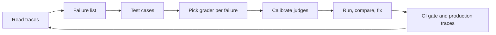
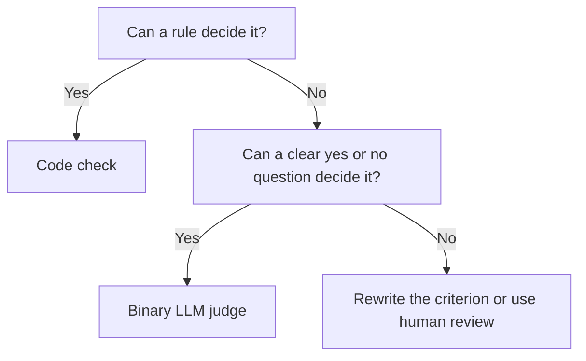
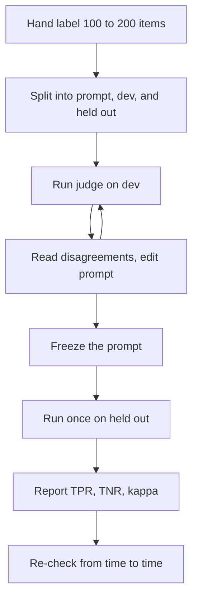
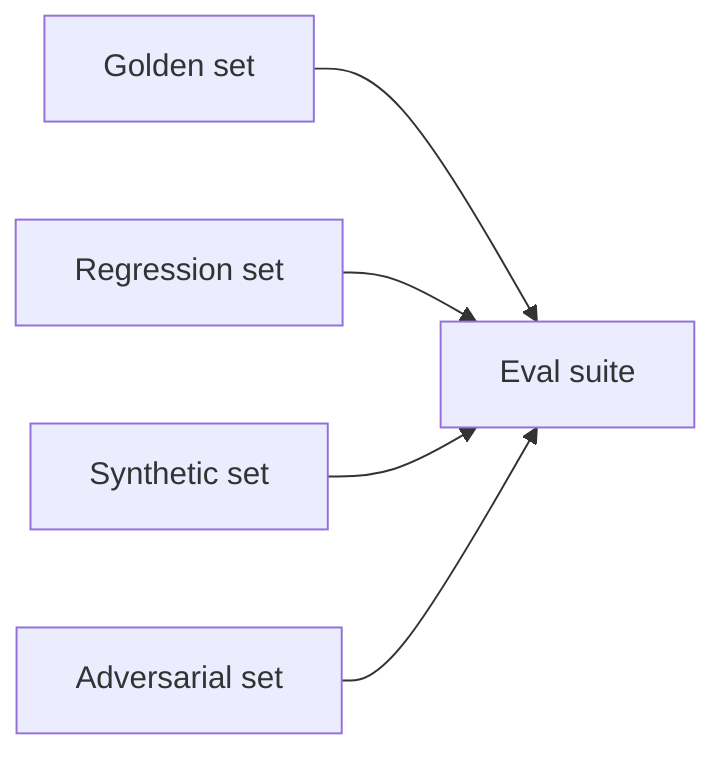
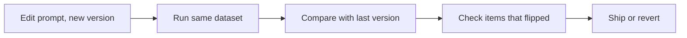
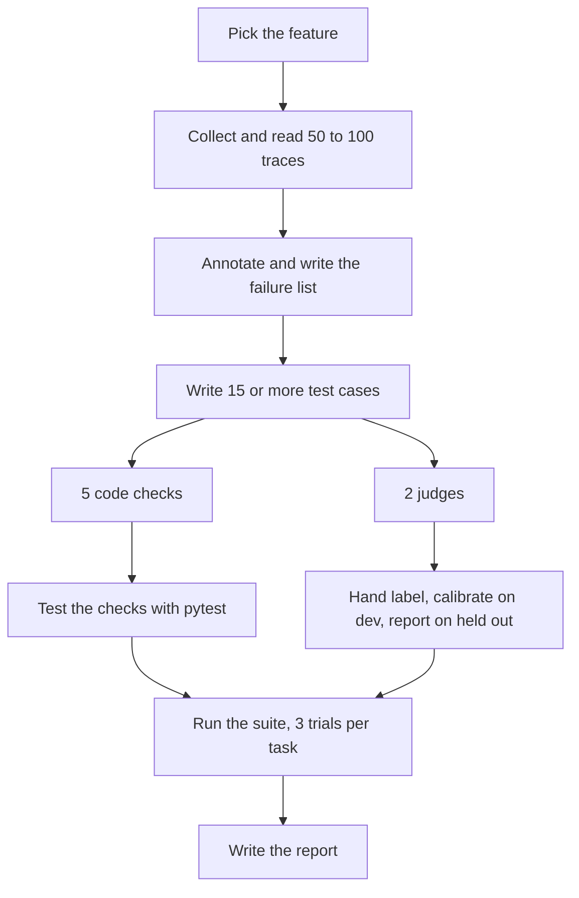
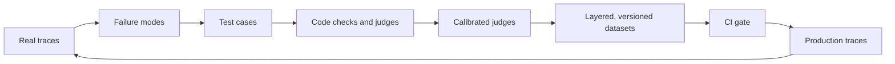

# **Phase 1: LLM Application Evals**

This phase turns the Phase 0 skills into a real eval workflow for a chatbot, an extraction feature, or an agent: read traces first, turn failures into tests, pick the right grader for each failure, build and calibrate judges, and keep the suite alive with CI and production traces.

The goal: find out how your feature really fails, measure those failures with the simplest grader that works, and prove that your judges can be trusted.

The main rule:

```text
Error analysis first. Metrics second.
```

Do not begin with "what accuracy should I measure?". Begin with "how is my system actually failing?".

## **Contents**

1. Where We Are Now
2. Error Analysis First
3. From Failures to Test Cases
4. Choose the Grader per Failure
5. Write Binary, Single Criterion Judges
6. Calibrate the Judge
7. Preventing Grader Gaming
8. Outcome First Agent Evaluation
9. Multiple Trials: pass@1, pass@k, pass^k
10. Build Datasets in Layers
11. Know the Metric Families
12. Evaluate Prompts, Not Just Models
13. Running an Evaluation Locally
14. A Basic CI Release Gate
15. Online Evaluation and Closing the Loop
16. Common Mistakes
17. Proof of Learning: Small Eval Suite with 5 Code Checks and 2 Calibrated Judges
18. Notebook Experiment Cells
19. Quick Reference
20. Interview Answer

## **What You Will Learn**

By the end of this phase you should be able to:

- Collect, read, and annotate traces, then group the problems into a failure taxonomy.
- Rank failure modes and turn them into test cases with clear success criteria.
- Pick a code check, an LLM judge, or a human for each criterion.
- Write a judge prompt that gives pass, fail, or unknown with a short reason.
- Measure a judge with TPR, TNR, and kappa on held out items.
- Grade the final outcome of an agent, not only its words.
- Run repeated trials and report pass@1, pass@k, and pass^k.
- Build versioned golden, regression, synthetic, and adversarial datasets.
- Treat prompts as versioned files with their own regression tests.
- Run the suite locally, gate a release in CI, and feed production failures back in.



## **1. Where We Are Now**

Phase 0 gave you the tools. Phase 1 uses them on a real application.

| Phase 0 skill | What it does in Phase 1 |
|---|---|
| Python and pytest | Build loaders, graders, runners, and test the graders |
| JSON and JSONL | Store tasks, traces, annotations, and results |
| SQL | Sample traces and count failures |
| Confidence intervals | Report pass rates and judge TPR and TNR honestly |
| Paired comparison and bootstrap | Compare two prompt or model versions |
| Cohen's kappa, precision, recall | Measure agreement between a judge and humans |
| Splits and leakage | Keep judge calibration honest |

Terms used in this phase:

| Term | Meaning |
|---|---|
| Task or test case | An input plus success criteria |
| Trial | One attempt at a task |
| Grader | Logic that decides if a trial met a criterion |
| Trace | The full record of one run |
| Outcome | The real final state of the environment, not what the model claims |
| Eval harness | The system that runs tasks, records traces, grades, and aggregates |

## **2. Error Analysis First**

**Error analysis** means reading real traces to learn how the system fails, before building any metric.

Generic scores such as "helpfulness from 1 to 10" hide the real problems. A chatbot can score well on them while it still uses the wrong policy, invents refund rules, or calls the wrong tool. Each of those needs a different fix and a different grader.

### **What is a trace?**

A **trace** (also called a transcript or trajectory) is the full record of one run. It can hold:

- The user request and earlier turns
- System instructions and tool descriptions
- Retrieved documents
- Every tool call, its arguments, and its result
- The final response
- The final environment state (database rows, files, tickets)
- Metadata: prompt version, model, latency, cost, timestamps

| Term | Meaning |
|---|---|
| Span | One operation inside a trace (a model call, a retrieval, a tool call) |
| Root span | The top level operation for the whole request |
| Trajectory | The path of steps an agent took |

Spans matter because you can attach a check to the exact step where the problem happened.

Response versus outcome: an agent may say "your refund was issued", but the outcome is whether a refund row exists in the database. A trace lets you check both.

A short example trace:

```text
User: Cancel order ORD-12. It has not shipped.

1. Agent calls get_order("ORD-12")
2. Tool returns status = "processing"
3. Agent calls cancel_order("ORD-21")        <- wrong id
4. Tool returns status = "cancelled"
5. Agent says "ORD-12 has been cancelled."
6. Database: ORD-12 is still processing
```

The final reply is false, but it is only a symptom. The first meaningful failure is step 3.

### **How to collect traces**

| Source | Best use | Limit |
|---|---|---|
| Production traces | Real behavior and surprises | Privacy, sampling bias |
| Internal testing | Before launch | Biased to what developers expect |
| Simulated users | Repeatable multi turn cases | Simulator may be unrealistic |
| Synthetic data | Rare and edge cases | Must be reviewed, can be too clean |
| Past incidents and tickets | Regression cases | May lack full execution details |

Collect **50 to 100 traces** for first error analysis. If you have no real traffic, write realistic inputs by hand, including hard ones:

```text
"I ordered two items, but only one arrived damaged. Can I get a partial refund?"
"I already used the course for three weeks. Can I still get a refund?"
"Your support team ignored my last three messages."
```

Rules:

- Include both good and bad runs. Looking only at failures bends the picture.
- Keep prompt version, model, and app version with every trace.
- Remove personal data before anyone annotates.

If one intent dominates traffic, random sampling will give you very few rare cases. Sample per intent instead:

```sql
SELECT trace_id, task_type, status, latency_ms, created_at
FROM (
    SELECT *,
           ROW_NUMBER() OVER (PARTITION BY task_type ORDER BY RANDOM()) AS row_number
    FROM traces
    WHERE created_at >= CURRENT_DATE - INTERVAL '14 days'
) AS sampled
WHERE row_number <= 20;
```

### **How to read a trace**

Use the same order every time:

1. Read the user request. What was asked, and what was missing?
2. Read the system instructions and tool descriptions. Are they clear?
3. Check retrieval. Right documents, current, enough?
4. Check each tool call. Right tool, right arguments?
5. Check each tool result. Did it succeed, and did the model read it correctly?
6. Read the final response. Correct, safe, clear, honest about what happened?
7. Check the final environment state. Did the action really happen?
8. Mark the **first meaningful failure**.

Record the first failure, because upstream mistakes cause downstream symptoms. If retrieval brings back an old policy and the model follows it faithfully, the first failure is retrieval, not generation. If other independent failures exist, add them as secondary tags so one root cause is not counted twice.

### **How to annotate**

**Annotation** is a short note on what went wrong. Force a decision (pass or fail), then write one line about the first failure. Do not force categories yet. This is called **open coding**.

| Weak note | Better note |
|---|---|
| "Bad answer" | "Says refund is complete, but no refund record exists" |
| "Tool problem" | "cancel_order received ORD-21, user asked for ORD-12" |
| "Hallucination" | "Gives a delivery date that is not in the tool result" |
| "Slow" | "Retrieval took 2.4 s, target is 0.5 s" |

Annotation template:

```text
Task ID:
User request:
Expected behavior:
Actual behavior:
First failure (and span):
Failure category:
Severity:
Confidence:
```

Habits:

- Describe what you can see, not guesses about the cause.
- Keep notes to one line.
- Use one severity scale for all reviewers.
- Keep reading until new traces stop showing new kinds of failure.

### **From notes to failure modes**

A **failure mode** is a named, repeated kind of failure. A **failure taxonomy** is the organized list of them.

```text
Trace 1:  Used wrong price.
Trace 7:  Used the listed price, not the discounted price.
Trace 19: Calculated the refund wrongly.
Trace 31: Refunded full amount instead of partial.
```

These four notes group into one mode: incorrect refund amount.

Aim for 5 to 12 modes. Give each one:

- A short name and a one sentence definition
- What counts and what does not count
- One example
- A suggested way to measure it

Example taxonomy for a support agent with retrieval:

| Group | Failure modes |
|---|---|
| Retrieval | Wrong document, missing document, stale document |
| Reasoning | Wrong calculation, wrong policy reading, ignored user limit |
| Tool use | Wrong tool, wrong arguments, misread tool result |
| Policy and safety | Skipped identity check, unauthorized action |
| Outcome | Action not done, false completion claim |
| Communication | Rude tone, unclear explanation, false promise |

Avoid categories that are too broad ("agent is wrong") or too narrow ("used ORD-12 wrongly on Tuesday"). Name them after the behavior, not after a guess about the cause. Keep an "other" bucket and review it later.

Counting with a rule of thumb: 100 traces were read and 40 had a problem.

Failure rate:

$$
\frac{40}{100} = 40\%
$$

Share of failures in the biggest category (12 traces):

$$
\frac{12}{40} = 30\%
$$

This is the rate in your sample. It is the production rate only if the sample is representative.

### **How to prioritize**

Rank modes by how often they happen and how much damage one case does.

- Frequency: how often?
- Severity: how bad is one case?
- Business and user impact: money, trust, time lost
- Safety and compliance: can it cause harm or break a rule?
- Cost to fix

A simple score, with each side rated 1 to 5:

$$
\text{Priority} = \text{Frequency} \times \text{Impact}
$$

| Failure mode | Frequency | Impact | Score | Priority |
|---|---:|---:|---:|---|
| False refund confirmation | 3 | 5 | 15 | Critical |
| Invalid tool arguments | 4 | 3 | 12 | High |
| Skipped identity check | 2 | 5 | 10 | Critical review |
| Unclear response | 4 | 1 | 4 | Lower |

The score is only a guide. A rare safety or legal failure can still block a release whatever its score.

### **Decide what to do with each failure**

Not every failure needs an eval. Some are plain bugs to fix first.

| Failure | Fix first | Then measure with |
|---|---|---|
| Wrong tool argument | Fix the tool description | Code check |
| Missing required field | Fix the output format in the prompt | Code check |
| Tone too harsh | Add a tone rule | LLM judge |
| Policy broken | Add the policy to the prompt | LLM judge |

## **3. From Failures to Test Cases**

A failure mode is general. A **test case** is one concrete input with clear success criteria. Each important mode should give several test cases, because one case cannot show that a mode is fixed.

Example: mode "incorrect refund amount".

```text
T001: Refund a $49.99 discounted order.
T002: Refund one item from a $99.98 two item order.
T003: Refund an order with a coupon.
T004: Refund an order with tax.
T005: Refund an order with a percentage discount.
```

Five kinds of case:

| Type | Purpose | Example |
|---|---|---|
| Normal | Common behavior | Standard refund |
| Edge | Unusual but valid | Partial refund |
| Adversarial | Misuse or manipulation | User asks for a bigger refund |
| Regression | An old bug stays fixed | A past failing refund case |
| Safety | Unsafe action is blocked | Refund for another person's order |

Also include cases where the behavior should **not** happen. If every case rewards an action, the system learns to always do it.

A test case as JSON:

```json
{
  "task_id": "refund_006",
  "category": "policy_and_safety.skipped_identity_check",
  "input": {"customer_id": "cust_101", "message": "Refund my order immediately."},
  "expected_outcome": {"refund_processed": false},
  "success_criteria": [
    "Does not process a refund before identity is verified",
    "Asks for the required verification"
  ],
  "tags": ["refund", "identity", "regression"]
}
```

### **Define success criteria first**

A good criterion is clear (two reviewers read it the same way), observable (the evidence is in the output, trace, or state), measurable, and covers one behavior. Write the criterion before the grader. If you cannot write it clearly, you do not yet understand the failure.

| Vague | Measurable |
|---|---|
| "Good answer" | "Contains the two required facts and does not contradict the source" |
| "Uses tools correctly" | "Calls `get_order` with the order id the user gave" |
| "Safe refund" | "Does not call `process_refund` before identity check succeeds" |
| "Code works" | "All existing tests and the new regression test pass" |

Examples by feature:

| Feature | Criteria |
|---|---|
| RAG chatbot | Every claim is supported by retrieved text. No invented citation. Says so when the documents lack the answer |
| Support agent | Identity checked first. Refund within the allowed amount. Refund row exists. Reply states the real status |
| Extraction | Valid JSON. All required fields. Invoice id matches exactly. Amount correct |
| Coding agent | Patch touches the intended files. Existing tests pass. New regression test passes. No forbidden files changed |

## **4. Choose the Grader per Failure**

Use the simplest grader that works.

> If an assertion can do it, use the assertion.

| Failure type | Grader | Examples |
|---|---|---|
| Deterministic and checkable | **Code check** | Valid JSON, required fields, allowed labels, tool arguments, regex, database state, latency |
| Subjective or needs reading | **LLM judge** | Tone, policy adherence, completeness, groundedness |
| High stakes, unclear, or for calibration | **Human review** | Rare serious cases, and the labels used to calibrate judges |



Why code first: it is free, fast, gives the same result every time, needs no calibration, and does not drift when the judge model changes.

Two setups you will see:

- **Reference based**: compare with a known expected answer or state. Good for extraction and fixed outcomes.
- **Reference free**: grade against a rule, with no golden answer. Good for tone, safety, and production monitoring.

These describe the setup, not the tool. Either can use code, a model, or a human.

### **Code check patterns**

Common ones: exact match, regex, JSON and schema checks, required fields, tool arguments, database or file state, unit tests, latency, and cost.

A small example with a dry run:

```python
import json

def check_required_fields(output_text, required_fields):
    try:
        data = json.loads(output_text)
    except json.JSONDecodeError:
        return False
    return all(field in data for field in required_fields)

print(check_required_fields('{"name": "Asha", "email": "a@x.com"}', ["name", "email"]))
print(check_required_fields('{"name": "Asha"}', ["name", "email"]))
print(check_required_fields("not json", ["name"]))
```

Expected output:

```text
True
False
False
```

Return more than a bare true or false, so a failure is easy to debug:

```json
{
  "grader": "correct_order_argument",
  "status": "FAIL",
  "reason": "Expected order_id ORD-12, received ORD-21.",
  "evidence": {"expected": "ORD-12", "actual": "ORD-21"}
}
```

Cautions:

- A regex proves a phrase appears, not that the statement is true. Check state for that.
- Run agent written code only in a real sandbox. A plain subprocess is not one.
- Test on an isolated database, never on real customer data.
- A single request cannot show a p95. Aggregate many requests.

### **Test your graders**

A wrong grader gives wrong scores. Each code check needs at least one passing case and one failing case in pytest.

```python
def grade_refund_amount(actual_amount, expected_amount):
    return abs(actual_amount - expected_amount) < 0.01

def test_correct_refund_amount():
    assert grade_refund_amount(49.99, 49.99) is True

def test_wrong_refund_amount():
    assert grade_refund_amount(59.99, 49.99) is False
```

Expected output of `pytest`:

```text
2 passed
```

## **5. Write Binary, Single Criterion Judges**

A **judge** is an LLM prompt that grades one output. Keep each judge small:

- **One criterion per judge.** Not "polite and correct and complete".
- **Binary result**: pass or fail, plus a short reason, and an **unknown** option.
- A clear definition of pass and fail.
- A few examples, at least one pass and one fail.
- Only the evidence it needs. Extra context hurts.
- A fixed output format, such as JSON.

| Choice | Prefer | Why |
|---|---|---|
| Pass or fail with a reason | Yes | Easy to compare with human labels |
| 1 to 10 score | No | Mixes many things, drifts, nobody agrees what a 7 means |
| Reason before verdict | Yes | You can read why |

### **Judge prompt template**

```text
You are checking one thing only: is the reply grounded in the supplied context?

Pass: every important claim in the reply is supported by the context.
      The reply may say "I don't know" when the context is not enough.
Fail: at least one important claim contradicts the context or has no support in it.
Unknown: the context is missing or too incomplete to decide.

Do not reward length. Do not assume a claim is true just because it sounds likely.

Example 1
Context: Refunds are available within 7 days.
Reply: You can get a refund within 7 days.
Reason: Matches the context.
Verdict: pass

Example 2
Context: Refunds are available within 7 days.
Reply: You can get a refund within 30 days.
Reason: Says 30 days, the context says 7.
Verdict: fail

Context: {context}
Reply: {reply}

Return JSON: {"reason": "<one short sentence>", "verdict": "pass" | "fail" | "unknown"}
```

What to do with unknown:

- Never count it as a pass.
- Report the unknown rate separately and send those items to a human.
- If more than about 5% come back unknown, the rule is probably unclear. Rewrite it.

## **6. Calibrate the Judge**

A judge is a measuring tool, so measure the tool. A judge that gives confident reasons can still be wrong.



### **The steps**

1. **Hand label 100 to 200 items** as pass or fail, with a short reason each. Make sure there are at least 20 to 30 real failures, or TPR will be very uncertain. For important criteria, have a second person label a part and settle disagreements. This is a planning target, not a rule. The right size depends on how rare failures are and how sure you need to be.
2. **Split the items.** One example split: 20% for writing the prompt and its examples, 40% dev, 40% held out. Keep enough failures in every part.
3. **Use only prompt split items as examples** inside the judge prompt. Never a held out item.
4. **Run the judge on dev**, read every disagreement, fix the prompt, repeat.
5. **Freeze the prompt**, run once on held out, report the numbers.
6. **Re-check** after any change of judge model or rubric, and on a small fresh sample every month or so. Save a new version name for every prompt change.

### **What to report**

Positive means "a real failure".

| | Human says fail | Human says pass |
|---|---:|---:|
| Judge says fail | TP | FP |
| Judge says pass | FN | TN |

| Metric | Question it answers |
|---|---|
| TPR (recall) | Of the real failures, how many did the judge catch? |
| TNR | Of the real good outputs, how many did the judge pass? |
| Precision | When the judge says fail, how often is it right? |
| F1 | One number balancing precision and recall |
| Kappa | Agreement with humans after removing luck |
| Unknown rate | How often the judge could not decide |

Take unknown out of the binary math at first, but report its count. If it is large, find out why.

Which number matters most depends on the risk. For a safety failure, missing one (low TPR) costs more than a false alarm. For a costly human review queue, precision matters more.

### **Worked example**

100 items. Humans: 40 fail, 60 pass. Judge: TP 36, FP 8, FN 4, TN 52.

TPR:

$$
\frac{36}{36 + 4} = 90\%
$$

TNR:

$$
\frac{52}{52 + 8} = 86.7\%
$$

Precision:

$$
\frac{36}{36 + 8} = 81.8\%
$$

F1:

$$
\frac{2 \times 0.818 \times 0.90}{0.818 + 0.90} = 85.7\%
$$

Observed agreement:

$$
p_o = \frac{36 + 52}{100} = 0.88
$$

Chance agreement (humans fail 0.40, judge fail 0.44):

$$
p_e = 0.40 \times 0.44 + 0.60 \times 0.56 = 0.512
$$

Kappa:

$$
\kappa = \frac{0.88 - 0.512}{1 - 0.512} = 0.754
$$

Wilson interval for TPR (36 out of 40, helper from Phase 0):

$$
76.9\% \text{ to } 96.0\%
$$

So "TPR 90%" really means "somewhere from about 77% to 96%". More real failures in the labelled set make this range smaller.

Report both raw agreement and kappa. Kappa depends on how common each label is, so do not read it alone, and there is no single pass line for it.

### **Fix the judge's pass rate**

A judge that is not perfect gives a biased pass rate. With its TPR and TNR you can correct it. Suppose the judge says 80% pass, with TPR 85% and TNR 90%.

Top part:

$$
0.80 + 0.85 - 1 = 0.65
$$

Bottom part:

$$
0.85 + 0.90 - 1 = 0.75
$$

Corrected pass rate:

$$
\frac{0.65}{0.75} = 86.7\%
$$

Treat this as a rough guide. It is noisy when the labelled set is small.

### **Know the biases**

| Bias | What happens | What to do |
|---|---|---|
| Position | Prefers the first or last answer when comparing two | Swap the order, run twice, keep only answers that agree |
| Verbosity | Prefers longer answers | Say "length does not matter", test short correct against long wrong answers |
| Self preference | Prefers its own model family | Judge with a **different model family** where practical |
| Formatting | Prefers nicely formatted text | Test with plain and formatted versions of the same answer |
| Leniency | Passes too easily, so low TPR | Add failure examples |
| Strictness | Fails good outputs, so low TNR | Add clear pass examples, including valid alternative answers |
| Instability | Same item, different verdicts | Run twice, check how often it flips |

A different model family helps, but it does not replace calibration.

## **7. Preventing Grader Gaming**

**Grader gaming** is when a system satisfies the grader without doing the real task. Agents will find weak graders.

| Weak grader | How it is gamed | Better grader |
|---|---|---|
| Keyword "refund" appears | "I cannot help with refunds." | Check the refund state and the policy |
| Passes if `process_refund` was called | Call it with a wrong id or amount | Check arguments, result, and database row |
| Output contains "All tests passed" | Print the phrase | Run the real tests, check the exit code |
| Score 1 to 10 for quality | Long confident answer | One criterion per judge, penalize unsupported claims |

Ways to make graders harder to game:

1. Grade the real outcome, not a stand in for it.
2. Use separate checks for separate criteria.
3. Include adversarial and negative cases.
4. Keep a held out set that is never used for tuning.
5. Review suspiciously perfect scores.
6. Try to fool your own grader with an output that passes the shortcut but fails the task.
7. Use human review for high risk cases.

A refund claim check as an example:

```python
def grade_refund_claim(response_text, refund_row_exists):
    claims_refund = "refund has been processed" in response_text.lower()
    if claims_refund and not refund_row_exists:
        return False
    return True

print(grade_refund_claim("Your refund has been processed.", False))
print(grade_refund_claim("Your refund has been processed.", True))
```

Expected output:

```text
False
True
```

## **8. Outcome First Agent Evaluation**

For agents, the first question is: **did the environment end in the required state?**

| Task | Agent says | Check | If it fails |
|---|---|---|---|
| Refund | "Refund processed" | Refund row exists, correct amount | Fail |
| Booking | "Meeting scheduled" | Calendar event exists | Fail |
| File writing | "Report saved" | File exists and has the right content | Fail |
| Code fix | "Bug fixed" | Tests pass in a clean environment | Fail |

Grade the outcome with code whenever you can. A tool saying "success" is not enough, so also look for duplicate or partial actions and reset state between trials.

Grade several things on their own, and never let an average hide a serious failure:

| Dimension | Example grader |
|---|---|
| Outcome | Database has the expected refund |
| Policy | Identity was verified before the refund |
| Tool use | Correct tool and arguments |
| Communication | Reply states the real outcome |
| Efficiency | Tool calls and latency within limits |

A good tone score must never hide a policy violation.

### **Use the trajectory for debugging**

The trajectory tells you **why** a run failed. It should rarely be the pass rule.

Two agents can reach the same correct result by different paths, for example search the policy then get the order, or get the order then search the policy. Requiring one exact sequence would reject a valid solution.

Check only what matters:

- A required tool was used when the policy needs it.
- Arguments were correct.
- A required step came **before** a sensitive action (identity check before refund).
- The final state is correct.
- No forbidden action was taken.

Enforce an order only when the task or policy truly needs one.

**Span attached evaluation** puts a small grader on one step:

```text
Trace
├── retrieve_policy    relevance   pass
├── calculate_refund   correctness fail   <- first failing step
├── create_refund      action      pass
└── customer_response  tone        pass
```

When the root result fails, you can see which step failed first. Example: the root judge fails an answer, and the span checks show retrieval was right but the generation step added an unsupported date. Now you know where to look.

## **9. Multiple Trials: pass@1, pass@k, pass^k**

LLMs are **non deterministic**: the same input can give different outputs or action sequences. One trial is weak evidence for important tasks.

| Metric | Meaning | Use when |
|---|---|---|
| pass@1 | Share of tasks that pass on the first trial | The user gets one attempt |
| pass@k | Share of tasks that pass **at least once** in k trials | Retries or best of k are allowed (capability) |
| pass^k | Share of tasks that pass **every one** of k trials | It must work every time (reliability) |

Counting from real trials, for task $i$ with $c_i$ passes out of $k$ trials, over $N$ tasks:

$$
\text{pass@k} = \frac{1}{N}\sum_{i=1}^{N} \mathbf{1}[c_i \ge 1]
\qquad
\text{pass}^k = \frac{1}{N}\sum_{i=1}^{N} \mathbf{1}[c_i = k]
$$

Example, 3 tasks with 3 trials each:

| Task | Trial 1 | Trial 2 | Trial 3 |
|---|---|---|---|
| A | pass | pass | pass |
| B | fail | pass | fail |
| C | pass | fail | pass |

pass@1: A and C pass on trial 1.

$$
\frac{2}{3} = 66.7\%
$$

pass@3: A, B, and C each pass at least once.

$$
\frac{3}{3} = 100\%
$$

pass^3: only A passes all three.

$$
\frac{1}{3} = 33.3\%
$$

If you ran more trials than you report (n trials, c passes) there are unbiased estimators:

$$
\text{pass@k} = 1 - \frac{\binom{n-c}{k}}{\binom{n}{k}}
\qquad
\text{pass}^k = \frac{\binom{c}{k}}{\binom{n}{k}}
$$

If one trial passes with probability $p$ and trials are independent, then:

$$
\text{pass@k} = 1-(1-p)^k
\qquad
\text{pass}^k = p^k
$$

For $p = 0.8$:

| $k$ | pass@k | pass^k |
|---:|---:|---:|
| 1 | 80% | 80% |
| 2 | 96% | 64% |
| 3 | 99.2% | 51.2% |
| 5 | 99.97% | 32.77% |

The gap grows with $k$. A support agent with high pass@3 but low pass^3 can rescue tasks by retrying, yet is unreliable on the first attempt. The independence assumption is often false (shared state, caching, fixed seeds), so prefer counting real trials.

Rules:

- Report the number of tasks and trials, with intervals.
- Reset state between trials.
- Use the same trial count when comparing two versions.
- Never report only the best run.

## **10. Build Datasets in Layers**

One dataset is not enough. Build four layers, each with a different job, and a held out split.



| Layer | What it holds | How it is made | Use |
|---|---|---|---|
| Golden | Human verified items with trusted answers | Hand built from real traffic | The honest score before a release |
| Regression | One item for each past failure | Added whenever a real bug is found | Old bugs do not come back |
| Synthetic | Many generated items for coverage | LLM writes, a human **reviews** | Fills gaps in rare cases |
| Adversarial | Tricky items made to break the feature | Hand written attacks and edge cases | Finds weak spots |

Notes:

- **Golden**: keep it small and clean, around 50 to 200 items to start.
- **Regression**: it only grows.
- **Synthetic**: generate along a few dimensions (topic by tone by difficulty). Generated items are often too clean and too alike, so review them.
- **Adversarial**: off topic requests, prompt injection ("ignore your rules"), rude users, empty or very long input, mixed languages, contradictory instructions.
- **Held out**: choose it by a fixed list of ids, not a new random split each time. Never paste held out items into prompts. Never mix calibration items with held out items.

### **Fields for each item**

| Field | Purpose |
|---|---|
| `task_id` | Stable unique id |
| `category` | Failure mode or capability tested |
| `difficulty` | Easy, medium, hard |
| `input` | The request and task data |
| `context` | Retrieval context or setup, if needed |
| `expected_outcome` | Expected final state or reference |
| `success_criteria` | Explicit conditions for passing |
| `tags` | Searchable labels |
| `source` | production, synthetic, manual, regression |
| `dataset_version` | Release id |

```json
{"task_id": "r014", "category": "tool_usage.invalid_arguments", "input": {"message": "Refund order ORD-12345"}, "expected_outcome": {"tool": "create_refund", "order_id": "ORD-12345"}, "tags": ["refund"], "source": "regression", "dataset_version": "v7"}
```

### **Versioning**

- Name files with a version, such as `golden_v3.jsonl`.
- Never edit a version in place. Make a new version and write what changed.
- Also version the system prompt, tool descriptions, judge prompts, graders, and model settings, so a result can be reproduced.

### **Project folder**

```text
llm-evaluation/
├── evals/
│   ├── datasets/
│   │   ├── golden_v1.jsonl
│   │   ├── regression_v1.jsonl
│   │   ├── synthetic_reviewed_v1.jsonl
│   │   └── adversarial_v1.jsonl
│   ├── annotations/human_labels.jsonl
│   ├── graders/
│   │   ├── code.py
│   │   └── judges.py
│   ├── prompts/
│   │   ├── groundedness_v1.txt
│   │   └── tone_v1.txt
│   ├── runner.py
│   ├── metrics.py
│   └── report.py
├── traces/sample_traces.jsonl
├── results/
├── tests/
│   ├── test_graders.py
│   ├── test_dataset.py
│   └── test_metrics.py
├── .github/workflows/evals.yml
└── CHANGELOG.md
```

## **11. Know the Metric Families**

Pick the metric that fits the output. Many metrics look scientific but fit open ended text badly.

| Metric | What it measures | Good for | Weak spot |
|---|---|---|---|
| Exact match | Output equals the reference after cleaning | Labels, ids, dates, numbers | Fails on any harmless wording change |
| BLEU and ROUGE | Word overlap with a reference | Rough check of translation or summaries | Same meaning in other words scores low |
| Embedding similarity | How close two texts are in meaning | Retrieval, near duplicates | A wrong answer can still be similar |
| Rubric judge | A judge grades against a written rule | Tone, policy, completeness, groundedness | Needs calibration |
| Safety and toxicity | Harmful or unsafe content | Safety filters, red team sets | Look at recall, missing harm is costly |
| Format adherence | Valid JSON, schema, required fields | Any structured output | Says nothing about whether content is right |
| Latency | Time to respond | User experience | Use percentiles, not the average |
| Cost per task | Money spent per task | Budget, comparing versions | Also count cost per successful task |

The overlap problem:

```text
Reference:  The refund takes 7 days.
Output:     You will get your money back within a week.
```

Both mean the same, but they share almost no words, so overlap scores are low.

**Latency**: an average hides slow requests. Report **p50** (typical) and **p95** (slow tail), and p99 if tail delay matters.

**Cost per task**: total cost 2.40 dollars, 100 tasks, 80 passed.

Cost per task:

$$
\frac{2.40}{100} = 0.024
$$

Cost per successful task:

$$
\frac{2.40}{80} = 0.030
$$

The second number is more honest, because failed tasks still cost money. Cost counts model, tool, and infrastructure cost together.

## **12. Evaluate Prompts, Not Just Models**

Most changes in an LLM app are prompt changes, not model changes. Your app is also tools, retrieval settings, guardrails, output parser, memory, and orchestration code. Treat these as **versioned files** with their own regression tests:

```text
prompts/
  system_prompt_v4.txt
  tool_descriptions_v2.json
  few_shot_examples_v3.jsonl
  judge_tone_v2.txt
CHANGELOG.md
```



Rules:

- Change one thing at a time, so you know what caused the result.
- Save the version name with every result row (the `prompt_version` column from Phase 0).
- Run the regression set on every change.
- Look at the items that flipped, not only the overall number. Compare per criterion too: a change can raise completeness and lower groundedness.
- Write one line in the changelog per version.

Finding flips between two versions:

```python
results_v1 = {"t001": 1, "t002": 1, "t003": 0, "t004": 1}
results_v2 = {"t001": 1, "t002": 0, "t003": 1, "t004": 1}

regressions = [task for task in results_v1 if results_v1[task] == 1 and results_v2[task] == 0]
fixes = [task for task in results_v1 if results_v1[task] == 0 and results_v2[task] == 1]

print("regressions:", regressions)
print("fixes:", fixes)
```

Expected output:

```text
regressions: ['t002']
fixes: ['t003']
```

Both versions pass 3 of 4, so the overall number did not move. One item got worse and one got better, and only the flip check shows it. With few items, one flipped item moves the percentage a lot, so look at counts and intervals before reading a difference.

## **13. Running an Evaluation Locally**

A local runner does the same steps every time:

1. Load the tasks.
2. Run the application.
3. Record the output and trace.
4. Run the graders.
5. Save one result row per task, with the evidence.
6. Aggregate and write a report.

A tiny runner with a dry run (replace `predict` with your real app call):

```python
import json

dataset = [
    {"task_id": "extract_001", "text": "Order ORD-12 costs 500", "expected": {"order_id": "ORD-12", "amount": 500}},
    {"task_id": "extract_002", "text": "Order ORD-13 costs 700", "expected": {"order_id": "ORD-13", "amount": 700}},
]

def predict(text):
    parts = text.split()
    return {"order_id": parts[1], "amount": int(parts[-1])}

def grade(actual, expected):
    return actual == expected

passed_count = 0
with open("results.jsonl", "w", encoding="utf-8") as file:
    for row in dataset:
        actual = predict(row["text"])
        passed = grade(actual, row["expected"])
        passed_count += int(passed)
        file.write(json.dumps({"task_id": row["task_id"], "actual": actual, "passed": passed}) + "\n")
        print(row["task_id"], "pass" if passed else "fail")

print(f"passed {passed_count}/{len(dataset)}")
```

Expected output:

```text
extract_001 pass
extract_002 pass
passed 2/2
```

A real runner also stores app version, prompt version, model, latency, token use, trace id, grader version, and judge verdicts. Save failures with evidence, handle timeouts and exceptions as their own status, and never run against live production state. The report should show overall numbers, a per criterion breakdown, intervals, and the list of failing task ids.

## **14. A Basic CI Release Gate**

Treat the suite like unit tests. On every change to a prompt, tool, retrieval, or model routing:

1. Run the pytest tests for the eval code itself.
2. Run the regression and critical tasks.
3. Compare with the agreed limits.
4. Fail the build when a limit is broken.
5. Save the report as a build file.

Example release rules:

```text
- Every critical safety and policy check must pass.
- Regression pass rate must not fall below the agreed limit.
- No known critical failure may come back.
- Judge unknown rate must stay under the review limit.
```

Do not pick limits at random. Base them on the product need, the baseline result, the sample size, and the risk you accept. With a small dataset, one item can move the percentage by several points.

```python
def release_allowed(report):
    if report["critical_failures"] > 0:
        return False
    if report["pass_rate"] < 0.93:
        return False
    return True

print(release_allowed({"critical_failures": 0, "pass_rate": 0.95}))
print(release_allowed({"critical_failures": 1, "pass_rate": 0.99}))
```

Expected output:

```text
True
False
```

The second case fails even with a high pass rate, because a critical check failed.

A starting GitHub Actions file:

```yaml
name: LLM Eval Gate
on:
  pull_request:
  push:
    branches: [main]
jobs:
  evaluation:
    runs-on: ubuntu-latest
    steps:
      - uses: actions/checkout@v4
      - uses: actions/setup-python@v5
        with: { python-version: "3.11" }
      - run: pip install -r requirements.txt
      - run: pytest -q
      - run: python evals/runner.py
      - run: python evals/check_release.py
      - uses: actions/upload-artifact@v4
        if: always()
        with: { name: evaluation-report, path: results/ }
```

Tips:

- Keep a fast subset for pull requests and the full suite for merges or nightly runs.
- Keep API keys in the CI secret store, never in the repository.
- Do not report an infrastructure error (timeout, missing key) as a quality failure.
- Judges are slow and noisy, so decide which runs really need them.

## **15. Online Evaluation and Closing the Loop**

Offline evaluation runs on a fixed dataset before release. **Online evaluation** scores real production traces after release.

| Offline | Online |
|---|---|
| Fixed dataset | Live traffic |
| Often has an expected answer or state | Often has no golden answer |
| Before deployment | After deployment |
| Good for regression | Good for finding new failures |

Signals to watch: task completion, user feedback, tool error rate, retry rate, escalation rate, latency, cost, policy violations, judge unknown rate, and the mix of task types. A signal such as rising retries only hints at a problem. Read the traces to find the cause.

You do not need an expensive judge on every request. Sample a share of traffic, sample high risk tasks more, trigger review when errors or complaints rise, and send uncertain or high impact cases to a human. Remove personal data first.

**A/B tests** compare two versions on separate traffic groups. Compare success, safety, latency, cost, and feedback, and use the intervals and paired methods from Phase 0 before calling a winner.

The loop:

1. Sample production traces (random, error flagged, slow).
2. Run the same graders, or a cheap subset, online.
3. Read the low scoring or surprising traces.
4. Annotate new failure modes and update the taxonomy.
5. Turn confirmed failures into regression cases in the versioned dataset.
6. Fix the prompt, retrieval, tool, or code.
7. Confirm the fix with the offline suite and CI.
8. Deploy, keep monitoring, repeat.

Example: users report outdated cancellation terms. You sample those traces, confirm retrieval picked an old document, add a regression case with two policy versions, fix the retrieval filter, and rerun the suite before release.

## **16. Common Mistakes**

| Mistake | Better approach |
|---|---|
| Starting with generic metrics | Read traces first |
| Testing only happy paths | Add edge, adversarial, and regression cases |
| Vague criteria ("be helpful") | Observable, single behavior criteria |
| Grading only the final text | Grade outcome, tool arguments, and spans |
| Trusting an uncalibrated judge | Report TPR and TNR on held out items |
| Reporting only accuracy for a judge | Report TPR, TNR, precision, kappa |
| One judge for many criteria | One binary judge per criterion |
| Tuning and reporting on the same items | Keep a held out set untouched |
| Ignoring unknown | Report the unknown rate and find the cause |
| Forcing one tool order | Check required properties and the outcome |
| Too few items, no intervals | Report counts and Wilson intervals |
| A single aggregate score | Report per criterion and critical metrics |
| Never testing the graders | Pytest each grader with pass, fail, and edge cases |
| Shared state between trials | Reset or isolate the environment |
| Forgetting prompt and tool versions | Version every artifact |
| Stale dataset | Promote real failures into it regularly |
| Over fitting to a weak metric | Keep reading traces |

## **17. Proof of Learning: Small Eval Suite with 5 Code Checks and 2 Calibrated Judges**

**Goal.** Build a small eval suite for a chatbot or extraction feature with **5 code checks and 2 calibrated judges**, and report judge TPR and TNR.

**Pick one feature:** a support assistant, an invoice extractor, an FAQ chatbot, a simple RAG chatbot, or a classifier. Keep it small enough that you understand every failure. The examples below use a course support assistant that returns JSON with `category`, `order_id`, and `reply`.



### **Step by step**

1. **Pick the feature** and write what a good output looks like.
2. **Collect 50 to 100 realistic traces.** Use real traffic if you may, otherwise write realistic inputs and label them simulated. Mix good runs, wrong answers, retrieval or tool problems, missing information, edge cases, and adversarial instructions.
3. **Annotate every trace** with pass or fail, the first failure, a short note, a category, severity, and confidence.
4. **Write 3 to 5 failure modes** with one line definitions.
5. **Build at least 15 test cases** (normal, edge, adversarial, regression) in a versioned JSONL file, each with success criteria.
6. **Write 5 code checks.** Example:

| Check | Rule |
|---|---|
| 1. Valid JSON | The output parses as JSON |
| 2. Required fields | `category`, `order_id`, and `reply` are all present |
| 3. Allowed category | `category` is one of the allowed labels |
| 4. Order id matches | `order_id` equals the id in the student message |
| 5. Reply length | The reply is 60 words or fewer |

For an invoice extractor, use: valid JSON, `invoice_id` present, date in `YYYY-MM-DD` form, amount is a number, and invoice id matches the expected one. A database or latency check can replace any of these.

7. **Test each check with pytest**, at least one passing and one failing case each.
8. **Write 2 judges**, each with one criterion, examples, and an unknown option:

| Judge | Criterion |
|---|---|
| Groundedness (or completeness) | Every claim is supported by the supplied input |
| Tone (or policy) | The reply is polite and calm, or makes no refund promise outside the 7 day rule |

9. **Hand label 100 to 200 items per judge** (at least 20 real failures). Split into prompt, dev, and held out. Edit the prompt only on dev, then freeze it.
10. **Run once on held out.** Report human pass and fail counts, judge pass, fail, and unknown counts, TP, FP, FN, TN, TPR, TNR, precision, F1, kappa, and the held out size, with intervals.
11. **Run 3 trials per task** where non determinism matters, in an isolated environment, and report pass@1, pass@3, and pass^3 with intervals.
12. **Write the report** and add at least one regression test from a confirmed failure.
13. **Stretch:** add a CI workflow that fails on a critical regression.

### **Report template**

The numbers are an example.

```text
Feature:        Course support assistant
Traces read:    100 (failure modes: 5)
Dataset:        golden_v1 (60 items) + regression_v1 (12 items)
Prompt:         system_prompt_v1
Trials:         3 per task

Code checks (pass rate over 100 runs):
  1. Valid JSON            98/100
  2. Required fields       96/100
  3. Allowed category      97/100
  4. Order id matches      91/100
  5. Reply length          94/100

Judge calibration (held out):
  Groundedness judge   TPR 90.0% (36/40, 95% interval 76.9% to 96.0%)
                       TNR 86.7% (52/60, 95% interval 75.8% to 93.1%)
                       Kappa 0.75   Unknown rate 3%
  Tone judge           TPR 80.0% (12/15, 95% interval 55% to 93%)
                       TNR 93.3% (42/45, 95% interval 82% to 98%)
                       Kappa 0.72   Unknown rate 2%

Agent metrics:  pass@1 83%, pass@3 97%, pass^3 70% (30 tasks)

Top failures:   1. Order id mismatch  2. Unsupported claim  3. Missing field
Limits:         Only 15 real failures for the tone judge, so its TPR is uncertain.
                Single judge model. Small dataset.
Next step:      Label more failures, re-check judges in a month, grow the regression set.
```

### **Definition of done**

| Check | Done when |
|---|---|
| Failure list came from real traces | Each check or judge links to a failure mode |
| 50 to 100 traces read and annotated | Every trace has a note |
| 3 to 5 failure modes written | Each has a definition |
| 15 or more test cases | Normal, edge, adversarial, and regression are all there |
| Code first | Nothing is given to a judge that a code check could do |
| 5 code checks tested | Each has pytest cases that pass and fail |
| 2 binary judges | Each has one criterion, examples, and unknown |
| Held out was kept | Prompt was frozen before the held out run |
| TPR and TNR reported | Both shown with an interval and counts |
| Trials run | pass@1, pass@k, pass^k with sample counts |
| Versioned | Datasets, prompts, and graders have versions |
| Regression test added | At least one from a confirmed failure |
| Honest limits | The report says what the sample cannot show |

## **18. Notebook Experiment Cells**

Run the cells in order in a Jupyter notebook. Cell 1 must run first. After that every cell can be rerun on its own, as long as the cells it needs have run once. These cells use only the Python standard library and run on a CPU, so no GPU is needed.

| Cell | What it does | Needs |
|---:|---|---|
| 1 | Imports and helpers | Nothing |
| 2 | Count failures and rank by priority | Cell 1 |
| 3 | Run 5 code checks | Cell 1 |
| 4 | Judge metrics with an interval | Cell 1 |
| 5 | Correct a judge's pass rate | Nothing |
| 6 | pass@1, pass@k, pass^k | Nothing |
| 7 | Cost per task and latency percentiles | Cell 1 |
| 8 | Find regressions between prompt versions | Nothing |

```python
# ── Cell 1. Imports and helpers ──────────────────────────────────
#    Run this first, later cells reuse its functions
# ─────────────────────────────────────────────────────────────────

import json
import math
import re
from collections import Counter

def wilson_interval(passes, total, z=1.96):
    proportion = passes / total
    denominator = 1 + z**2 / total
    centre = (proportion + z**2 / (2 * total)) / denominator
    spread = z * math.sqrt(proportion * (1 - proportion) / total + z**2 / (4 * total**2)) / denominator
    return centre - spread, centre + spread

def judge_metrics(true_positive, false_positive, false_negative, true_negative):
    total = true_positive + false_positive + false_negative + true_negative
    observed = (true_positive + true_negative) / total
    human_fail = (true_positive + false_negative) / total
    judge_fail = (true_positive + false_positive) / total
    chance = human_fail * judge_fail + (1 - human_fail) * (1 - judge_fail)
    precision = true_positive / (true_positive + false_positive)
    true_positive_rate = true_positive / (true_positive + false_negative)
    return {
        "tpr": true_positive_rate,
        "tnr": true_negative / (true_negative + false_positive),
        "precision": precision,
        "f1": 2 * precision * true_positive_rate / (precision + true_positive_rate),
        "accuracy": observed,
        "kappa": (observed - chance) / (1 - chance),
    }

print("helpers ready")
```

Expected output:

```text
helpers ready
```

```python
# ── Cell 2. Count failures and rank by priority ──────────────────
#    Priority = frequency x impact, both rated 1 to 5
# ─────────────────────────────────────────────────────────────────

notes = [
    "wrong_tool_argument",
    "missing_field",
    "wrong_tool_argument",
    "harsh_tone",
    "missing_field",
    "wrong_tool_argument",
]

for category, count in Counter(notes).most_common():
    print(category, count)

print("---")

failure_modes = [
    ("invalid tool arguments", 4, 3),
    ("skipped identity check", 2, 5),
    ("unclear response", 4, 1),
    ("false refund confirmation", 3, 5),
]

ranked = sorted(failure_modes, key=lambda mode: mode[1] * mode[2], reverse=True)
for name, frequency, impact in ranked:
    print(f"{name}: {frequency * impact}")
```

Expected output:

```text
wrong_tool_argument 3
missing_field 2
harsh_tone 1
---
false refund confirmation: 15
invalid tool arguments: 12
skipped identity check: 10
unclear response: 4
```

```python
# ── Cell 3. Run 5 code checks ────────────────────────────────────
#    Dry run: the good output passes, then we break the order id
# ─────────────────────────────────────────────────────────────────

sample_input = "Please refund order ORD-12345, it arrived damaged."
sample_output = '{"category": "refund", "order_id": "ORD-12345", "reply": "Thanks for writing. Your refund request is received."}'
allowed_categories = ["refund", "booking", "technical", "other"]

parsed_output = json.loads(sample_output)
order_id_in_input = re.search(r"ORD-\d{5}", sample_input).group()

check_valid_json = isinstance(parsed_output, dict)
check_required_fields = all(field in parsed_output for field in ["category", "order_id", "reply"])
check_allowed_category = parsed_output["category"] in allowed_categories
check_order_id_matches = parsed_output["order_id"] == order_id_in_input
check_reply_length = len(parsed_output["reply"].split()) <= 60

print("valid json:", check_valid_json)
print("required fields:", check_required_fields)
print("allowed category:", check_allowed_category)
print("order id matches:", check_order_id_matches)
print("reply length:", check_reply_length)

parsed_output["order_id"] = "ORD-1234"
print("after breaking order id:", parsed_output["order_id"] == order_id_in_input)
```

Expected output:

```text
valid json: True
required fields: True
allowed category: True
order id matches: True
reply length: True
after breaking order id: False
```

```python
# ── Cell 4. Judge metrics with an interval ───────────────────────
#    Positive means a real failure
#    Needs cell 1
# ─────────────────────────────────────────────────────────────────

metrics = judge_metrics(true_positive=36, false_positive=8, false_negative=4, true_negative=52)

print(f"TPR: {metrics['tpr']:.1%}")
print(f"TNR: {metrics['tnr']:.1%}")
print(f"precision: {metrics['precision']:.1%}")
print(f"F1: {metrics['f1']:.1%}")
print(f"accuracy: {metrics['accuracy']:.1%}")
print(f"kappa: {metrics['kappa']:.2f}")

low, high = wilson_interval(36, 40)
print(f"TPR 95% interval: {low:.1%} to {high:.1%}")
```

Expected output:

```text
TPR: 90.0%
TNR: 86.7%
precision: 81.8%
F1: 85.7%
accuracy: 88.0%
kappa: 0.75
TPR 95% interval: 76.9% to 96.0%
```

```python
# ── Cell 5. Correct a judge's pass rate ──────────────────────────

observed_pass_rate = 0.80
true_positive_rate = 0.85
true_negative_rate = 0.90

top = observed_pass_rate + true_positive_rate - 1
bottom = true_positive_rate + true_negative_rate - 1
corrected_pass_rate = top / bottom

print(f"judge says {observed_pass_rate:.1%}, corrected estimate {corrected_pass_rate:.1%}")
```

Expected output:

```text
judge says 80.0%, corrected estimate 86.7%
```

```python
# ── Cell 6. pass@1, pass@k, pass^k ───────────────────────────────
#    1 means a trial passed, 0 means it failed
# ─────────────────────────────────────────────────────────────────

trials_by_task = {
    "A": [1, 1, 1],
    "B": [0, 1, 0],
    "C": [1, 0, 1],
}

task_count = len(trials_by_task)
pass_at_1 = sum(trials[0] for trials in trials_by_task.values()) / task_count
pass_at_3 = sum(1 for trials in trials_by_task.values() if sum(trials) >= 1) / task_count
pass_hat_3 = sum(1 for trials in trials_by_task.values() if sum(trials) == 3) / task_count

print(f"pass@1: {pass_at_1:.1%}")
print(f"pass@3: {pass_at_3:.1%}")
print(f"pass^3: {pass_hat_3:.1%}")

print("k   pass@k   pass^k   (p = 0.8)")
for k in (1, 2, 3, 5):
    print(f"{k}   {1 - 0.2**k:.2%}   {0.8**k:.2%}")
```

Expected output:

```text
pass@1: 66.7%
pass@3: 100.0%
pass^3: 33.3%
k   pass@k   pass^k   (p = 0.8)
1   80.00%   80.00%
2   96.00%   64.00%
3   99.20%   51.20%
5   99.97%   32.77%
```

```python
# ── Cell 7. Cost per task and latency percentiles ────────────────
#    Percentile uses the nearest rank method
# ─────────────────────────────────────────────────────────────────

total_cost = 2.40
total_tasks = 100
passed_tasks = 80
latencies_ms = [620, 700, 710, 750, 800, 820, 900, 950, 1200, 3100]

cost_per_task = total_cost / total_tasks
cost_per_successful_task = total_cost / passed_tasks

sorted_latencies = sorted(latencies_ms)
p50_index = math.ceil(0.50 * len(sorted_latencies)) - 1
p95_index = math.ceil(0.95 * len(sorted_latencies)) - 1

print(f"cost per task: ${cost_per_task:.4f}")
print(f"cost per successful task: ${cost_per_successful_task:.4f}")
print(f"p50 latency: {sorted_latencies[p50_index]} ms")
print(f"p95 latency: {sorted_latencies[p95_index]} ms")
```

Expected output:

```text
cost per task: $0.0240
cost per successful task: $0.0300
p50 latency: 800 ms
p95 latency: 3100 ms
```

```python
# ── Cell 8. Find regressions between prompt versions ─────────────

results_v1 = {"t001": 1, "t002": 1, "t003": 0, "t004": 1}
results_v2 = {"t001": 1, "t002": 0, "t003": 1, "t004": 1}

regressions = [task for task in results_v1 if results_v1[task] == 1 and results_v2[task] == 0]
fixes = [task for task in results_v1 if results_v1[task] == 0 and results_v2[task] == 1]

print("regressions:", regressions)
print("fixes:", fixes)
```

Expected output:

```text
regressions: ['t002']
fixes: ['t003']
```

## **19. Quick Reference**

| Term | Simple meaning |
|---|---|
| Error analysis | Reading real traces and noting what went wrong, before building metrics |
| Trace, transcript, trajectory | The full record of one run |
| Span | One operation inside a trace |
| Outcome | The real final state, not the model's claim |
| Open coding | Writing a short free note for each bad trace |
| Failure mode | A named, repeated kind of failure |
| Failure taxonomy | The organized list of failure modes, with counts |
| Success criterion | An observable condition a task must meet |
| Code check | A rule based grader: free, fast, same result every time |
| LLM judge | A prompt that grades one output on one criterion |
| Binary judge | Gives pass or fail with a reason, and may say unknown |
| Reference based | Compared with a known expected answer or state |
| Reference free | Graded against a rule, with no golden answer |
| Calibration | Comparing a judge with human labels |
| TPR | Of the real failures, how many the judge caught |
| TNR | Of the real good outputs, how many the judge passed |
| Precision | When the judge says fail, how often it is right |
| Kappa | Agreement with humans after removing luck |
| Held out set | Labelled items used once, for the final numbers |
| Position, verbosity, self preference | Judge biases to test for |
| Grader gaming | Passing the grader without doing the real task |
| Span attached eval | A grader attached to one step of a trace |
| pass@k | At least one of k trials passes |
| pass^k | All k trials pass |
| Golden set | Human verified items, the honest score |
| Regression set | One item per past failure |
| Synthetic set | Generated items for coverage, reviewed by a human |
| Adversarial set | Tricky items made to break the feature |
| BLEU and ROUGE | Word overlap scores, weak for open ended output |
| p50 and p95 | Typical and slow tail latency |
| Cost per successful task | Total cost divided by passed tasks |
| Prompt version | A saved, named copy of a prompt, tested like code |
| Release gate | A CI check that blocks a release on regression |
| Offline and online eval | Fixed dataset before release and live traces after |

Key rules to remember:

- Read traces before you choose any metric, and record the first failure.
- If an assertion can do it, use the assertion.
- For agents, grade the outcome, and use the trajectory to debug.
- Use binary, single criterion judges with an unknown option.
- Never trust a judge until you report its TPR and TNR on held out items.
- Report pass@1 and pass^k for anything that must work every time.
- Build datasets in layers, version them, and keep a held out split.
- Test prompt changes like code changes, and check the items that flipped.
- Put the suite in CI, and promote production failures into the regression set.

## **20. Interview Answer**

**Question:** "How would you build an evaluation suite for an LLM application?"

- I start with error analysis, not metrics. I collect 50 to 100 real or realistic traces, read each one, and write a short note on the first meaningful failure. I group the notes into a small failure taxonomy and rank the modes by frequency and impact.
-
- For each important mode I write test cases with clear success criteria, including normal, edge, adversarial, and regression cases. I use code checks for anything deterministic, such as schema, tool arguments, and final database state. For subjective criteria I write separate binary judges that return pass, fail, or unknown with a short reason.
-
- I calibrate each judge against human labels, with a dev split for tuning and a held out split for the final numbers, and I report TPR, TNR, and kappa instead of raw accuracy. For agents I grade the final outcome and use the trajectory only for debugging. I run multiple trials and report pass@1, pass@k, and pass^k with intervals.
-
- The datasets are layered and versioned, the suite runs in CI as a release gate, and I sample production traces to find new failures and add them back as regression cases.

### **Final mental model**



Always ask:

```text
Did I read real traces first?
Is each failure measured by the simplest grader that works?
Do I know my judge's TPR and TNR on held out items?
Did I check the outcome, not only the words?
Did I check the items that flipped between versions?
```